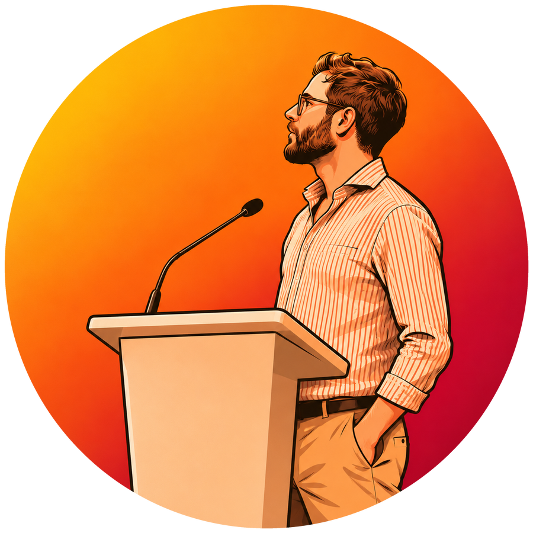

# Hi I'm Kenneth 👋

<a class="md-button" href="mailto:kce.prognosis296@passinbox.com">Contact me</a>

I am an assistant professor at Aarhus University, an open-source developer and researcher.

My two current research passions are:

- **Continuous development of language models**: How do we best get to a point where we see PRs on large models? This research touches on continual learning, resource-efficient representation learning, and model and data governance.
- **Evaluation and meta-evaluation of language models**: Can we estimate performance on new, unseen samples? What is the relation between language and mathematical reasoning? This work has applications in efficient evaluation, model development, adaptive evaluation, and test-time evaluation—and more broadly helps us understand intelligence itself.

I have publications spanning artificial intelligence, natural language processing, psychiatry, cognitive science, computational humanities, and bioinformatics. While I love interdisciplinary work, most of my time is spent in the fields at the start of that list.

I've found that I wholeheartedly enjoy the scientific method, to the point where I find variable control enjoyable even when brewing coffee. And why wouldn't you? Learning is fun, and you can't learn if you don't measure your coffee down to the gram! Besides coffee and science, I also enjoy cooking and staying active.
